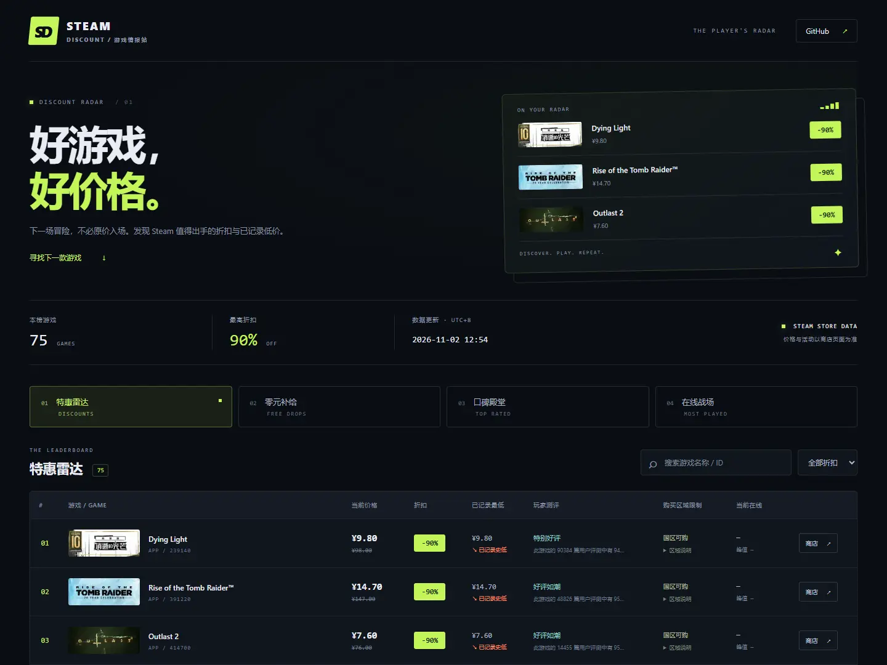

# steam-discount

> Steam 特惠游戏榜单 [ [Link](https://exp-tools.github.io/steam-discount/) ]

------

## 运行环境


## 项目介绍

从 Steam 商城爬取游戏的【打折（史低）】、【零元购】、【测评】、【热度】情况的榜单整理并展示。



> 随着脚本的运行次数越来越多，缓存到本地的数据库会越来越完善


## 官方接口文档

- https://steamcommunity.com/dev?l=schinese
- https://partner.steamgames.com/doc/webapi


## 开发者部署


本项目已配置 [Github Actions](https://docs.github.com/cn/actions/configuring-and-managing-workflows/configuring-a-workflow)，因此你只需轻松几步即可实现部署：

- [Fork 本项目](https://github.com/EXP-Tools/steam-discount/) 到你的代码仓库
- 通过 Settings --> Secrets --> Actions 配置以下变量：
    - `CRAWL_PWD`：与 `main.py` 中的 `GIT_CRAWL_PWD` 保持一致；未配置或不匹配时流水线会报错
    - `PAGES`： 爬取 steam 商城的游戏页数，建议 5
    - `ZONE`： 指定 steam 商城的地区，会影响售价单位，默认 CN （RMB）
    - `LIMIT`：每榜展示数量，默认及上限均为 100
    - `FILTER`： 其他过滤参数，建议 globaltopsellers
- 启用 Settings --> Actions 功能

> 程序默认每天 UTC 12:00（北京时间 20:00）执行，并自动生成 [Github Page](https://exp-tools.github.io/steam-discount/) 特惠排行榜单。执行频率由 [`autorun.yml`](.github/workflows/autorun.yml) 的 `schedule` 配置决定。拉取请求只运行离线测试，不抓取或提交数据。

## 本地运行与验证

```sh
python -m pip install -r requirements.txt
python -m unittest discover -s tests -v
python main.py -p 5 -z CN -l 100 -s
```

如需代理，追加 `-c 127.0.0.1:18888`。请求会设置连接、读取超时；HTTP 错误和解析错误会记录具体原因。所有热销页抓取失败时停止生成页面；热度榜失败时保留上一次的排名和热度页。

抓取兼容 Steam 当前商城价格节点、旧版价格结构和新版热度表格，测评支持好评、褒贬不一与差评。没有售价的条目会跳过，不会导致整页更新失败。零元购显示付费游戏的 100% 优惠，常驻免费游戏不再误标为 100% 折扣。

四个榜单采用游戏风深色界面，提供本页搜索、折扣筛选和手机卡片布局。每榜最多展示 100 款游戏；特惠和零元购仅使用本次成功刷新价格的游戏，避免将过期优惠当作当前活动。

封面保存为 176×66 的 WebP 缩略图（质量 65），页面按需加载，复用已有封面并清理不再引用的图片。原图不保存到仓库。

“购买区域限制”按 `ZONE` 核验商店，默认 CN。公开售价表示该区域商店可购；商品页披露的区域限制可展开查看。跨区激活、赠送和第三方 Key 的适用区域无法由售价推断，未披露时会明确说明。每次运行最多核验 20 个商品详情，缓存 7 天；未核验的商品显示“待核验”。

“史低”指本地数据库自开始采集以来记录到的最低价，并非 Steam 全历史最低价。`tests/fixtures` 保存了从真实 Steam 页面截取的最小样例，测试无需访问网络。

## 数据与仓库体积

- `data/lowest-prices.csv` 保留全部游戏 ID 和已记录最低价，按 ID 排序，方便 Git 只保存价格变化。
- `data/catalog.json` 只保存四个榜单需要的展示记录（每榜最多 100，去重合并）。
- `data/region-info.json` 保存区域核验结果。
- `data/steam.db` 是忽略提交的本地工作数据库，首次运行自动由上述记录恢复；不要删除 `lowest-prices.csv`。

旧版数据库中的全部史低记录迁移到 CSV 后，工作数据库无需继续提交。既有 Git 历史中的大数据库仍会影响完整克隆体积；普通使用可用 `git clone --depth 1`。本次调整不重写已发布的 Git 历史。


## 目录说明

```
steam-discount
├── README.md ............................... [项目说明]
├── main.py ................................. [程序运行入口]
├── data
│   ├── lowest-prices.csv ................... [全部游戏的史低价]
│   ├── catalog.json ........................ [榜单展示记录]
│   └── steam.db ............................ [本地工作缓存，不提交]
├── docs .................................... [Github Page 特惠排行一览]
├── src ..................................... [项目源码]
├── script .................................. [数据库脚本]
├── tpl ..................................... [模板文件]
└── log ..................................... [项目日志]
```
